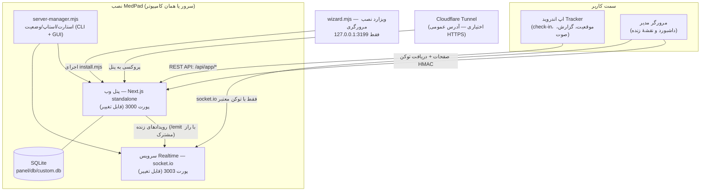

# MedPad

> **سامانهٔ مدیریت و پیگیری میدانیِ کاملاً آفلاین** — پنل وب + سرویس Realtime + اپلیکیشن اندروید، با نصب‌کننده‌ای که همه‌چیز (حتی Node.js) را داخل بسته دارد.

MedPad برای تیم‌هایی ساخته شده که کارمندانشان در میدان (مانند ویزیتورهای پزشکی) بین مشتریان جابه‌جا می‌شوند: کارمند با اپ اندروید **ورود/خروج (check-in/checkout)** خود و **موقعیت مکانی** را ثبت می‌کند، گزارش‌های روزانه می‌گیرد و یادداشت صوتی ضبط می‌کند؛ مدیر هم در **پنل وب** مشتریان و کارمندان را مدیریت می‌کند و **موقعیت زندهٔ** نیروها را روی نقشه می‌بیند. همه‌چیز روی سرور خودتان اجرا می‌شود — بدون سرویس ابری، بدون اشتراک، و حتی **بدون اینترنت** نصب می‌شود.

**وضعیت فعلی:** نسخهٔ `1.9.12` — دورهٔ کامل ممیزی و سخت‌سازی امنیتی (هفت فاز + فاز صفر) روی آن اجرا شده و **۹۲ تست خودکار** (نصب، بوت، احراز هویت، امنیت ویزارد/سوکت، ایمنی پروسه‌ها، جریان Cloudflare) پاس شده است. جزئیات در [SECURITY-AUDIT-v1.9.12.md](SECURITY-AUDIT-v1.9.12.md).

| | |
|---|---|
| 📦 راهنمای کامل نصب و عیب‌یابی | [README-fa.md](README-fa.md) |
| 🔒 گزارش ممیزی امنیتی | [SECURITY-AUDIT-v1.9.12.md](SECURITY-AUDIT-v1.9.12.md) |
| 🔑 امضای اندروید و چرخش کلید | [Android/ANDROID-SIGNING.md](Android/ANDROID-SIGNING.md) |
| 🧪 اجرای تست‌ها | [`bash audit-tests/run-all.sh`](#تست-و-توسعه) |
| 📜 تاریخچهٔ کامل پروژه | [WORKLOG-MedPad.md](WORKLOG-MedPad.md) |

---

## قابلیت‌های کلیدی (تأییدشده در کد)

| قابلیت | توضیح |
|---|---|
| 🖥 **پنل وب مدیریت** | ورود مدیر (با محدودیت نرخ تلاش)، داشبورد آماری، مدیریت مشتریان/کارمندان/تخصیص‌ها، ثبت check-in، و نقشهٔ موقعیت زنده |
| 📡 **سرویس Realtime** | socket.io روی پورت جداگانه؛ اتصال داشبورد فقط با **توکن HMAC کوتاه‌عمر** که پنل برای مدیر می‌سازد — اتصال ناشناس/جعلی رد می‌شود |
| 🤖 **اپ اندروید Tracker** | ورود کارمند با آدرس سرور، check-in/checkout با موقعیت، نقشهٔ مشتریان (osmdroid)، گزارش‌های شمسی، یادداشت صوتی، و **صف آفلاین** (Room) با همگام‌سازی بعدی |
| 📦 **نصب ۱۰۰٪ آفلاین** | Node.js v24 (MSI + tarball) + همهٔ وابستگی‌ها + بیلد production پنل + انجین‌های Prisma داخل بسته — بدون `npm install` و بدون دانلود |
| 🧙 **نصب‌کننده گرافیکی مرورگری** | ویزارد فارسی RTL فقط روی `127.0.0.1` با لاگ زندهٔ نصب؛ محافظت Host/Origin در برابر CSRF و DNS-rebinding |
| ⚙️ **مدیریت سرور CLI + GUI** | `server-manager.mjs` برای استارت/استاپ/ری‌استارت/وضعیت با **اثبات مالکیت پروسه** پیش از هر kill — پروسهٔ خارجی هرگز کشته نمی‌شود |
| 🌐 **حالت‌های آدرس** | شبکهٔ محلی (آفلاین) · سرور لینوکسی با systemd · تونل Cloudflare (آدرس عمومی HTTPS) با طرح DNS و تأیید و بکاپ پیش از هر تغییر |
| 🔐 **امنیت پیش‌فرض** | بدون رمز پیش‌فرض (نصب عمومی رمز قوی می‌خواهد؛ نصب محلی رمز تصادفی یک‌بار‌نمایش می‌سازد)، توکن‌ها با CSPRNG، `.env` و دیتابیس فقط-مالک (600/700) |

> موارد برنامه‌ریزی‌شده (هنوز پیاده‌سازی نشده) در بخش [وضعیت و نقشه راه](#وضعیت-فعلی-و-نقشه-راه) آمده‌اند.

## معماری



**اجزای اصلی:**

- **پنل وب** (`app/panel/`) — اپ Next.js به‌صورت خروجی standalone از پیش ساخته‌شده؛ سورس کامل آن در `medpad-full-1.9/inst-stage/panel-src/` نگهداری می‌شود. داده‌ها در SQLite (Prisma) ذخیره می‌شوند.
- **سرویس Realtime** (`app/realtime/`) — Node + socket.io؛ رویدادهای موقعیت را از پنل می‌گیرد و فقط به داشبوردهای **احراز هویت‌شده** می‌رساند.
- **اپ اندروید** (`Android/`) — Kotlin با ViewBinding؛ آدرس سرور را کارمند در زمان ورود وارد می‌کند؛ دادهٔ همگام‌نشده در Room ذخیره و بعداً سینک می‌شود.
- **نصب‌کننده** (`install.mjs` + `install.bat/.ps1/.sh` + `wizard.mjs` + `ui/`) — خط لولهٔ آفلاین کامل؛ در ویندوز/لینوکس منوی تعاملی یا ویزارد مرورگری باز می‌کند.
- **مدیریت سرویس** (`services.mjs` + `server-manager.mjs`) — تنها نقطهٔ استارت/استاپ؛ هر kill نیازمند اثبات مالکیت (مسیر اسکریپت/cwd/زمان شروع) است.
- **تونل** (`tunnel.mjs` + `lib/cloudflare.mjs`) — راه‌اندازی اختیاری تونل Cloudflare با جریان امنِ «طرح ← تأیید ← بکاپ ← اعمال ← بازگشت در صورت خطا».
- **بستهٔ آفلاین** (`offline/`) — Node.js v24.21.0 برای ویندوز (MSI) و لینوکس (tar.xz).
- **آرشیو** (`medpad-full-1.9/`) — نگه‌داری نسخه‌های قبلی/کاری: بستهٔ WIP نسخهٔ 1.9.12، سورس پنل (`inst-stage/panel-src/`)، کپی دوم سورس اندروید و APK امضاشدهٔ قدیمی.

## نصب

### پیش‌نیازها

- **بستهٔ نصب (پیشنهادی):** هیچ پیش‌نیازی ندارد — حتی Node.js هم داخل بسته است (`offline/`). فقط ویندوز x64 یا لینوکس x64.
- **کلون این مخزن:** Git + Node.js نسخهٔ 20 به بالا (برای اجرای `install.mjs`)؛ سپس همان نصب‌کنندهٔ آفلاین اجرا می‌شود.

### ویندوز (x64)

1. پوشه را کامل Extract کنید (اجرا از داخل ZIP خطا می‌دهد)
2. روی `install.bat` دابل‌کلیک کنید و UAC را تأیید کنید
3. در منو، مقصد (این کامپیوتر / VPS لینوکسی / Cloudflare) و رابط (مرورگری یا CLI) را انتخاب کنید
4. در پایان، `start.bat` پنل را بالا می‌آورد و صفحه را در مرورگر باز می‌کند

### لینوکس (x64)

```bash
bash install.sh        # منو: مقصد + رابط (پیشنهادی: ویزارد مرورگری)
./start-server.sh      # استارت + باز شدن خودکار پنل
./server-manager.sh    # مدیریت گرافیکی (استارت/استاپ/ری‌استارت)
```

اگر Node.js نباشد، از `offline/node-*.tar.xz` استخراج می‌شود (نیازمند `xz-utils`).

> 🖥 **سرور بدون مانیتور (headless):** ویزارد فقط روی `127.0.0.1` گوش می‌دهد؛ با تونل SSH بازش کنید:
> `ssh -L 3199:localhost:3199 user@server` و در لپ‌تاپ `http://localhost:3199`

### رمز مدیر — بدون پیش‌فرض

از v1.9.12 رمز `admin123` به‌کلی حذف شده است: نصب عمومی (VPS/Cloudflare) بدون **رمز قوی** انجام نمی‌شود، و نصب محلیِ تازه بدون رمز، یک **رمز تصادفی امن** می‌سازد و فقط یک‌بار نشان می‌دهد. داده‌های نمونه (کارمندان/مشتریان آزمایشی) هم فقط با درخواست صریح (`--with-sample-data` یا چک‌باکس ویزارد) ساخته می‌شوند.

راهنمای کامل گام‌به‌گام، جدول فایل‌های تولیدشده و عیب‌یابی: **[README-fa.md](README-fa.md)**

## پیکربندی و امنیت

- **تنظیمات نصب** در `medpad-config.json` (پورت‌ها، کاربر مدیر، نوع نصب) و **اسرار** در `panel/.env` (شامل `SOCKET_TOKEN` و `DATABASE_URL`) نگهداری می‌شوند. این فایل‌ها تولید محلی‌اند و **هرگز نباید commit شوند** (در `.gitignore` مسدود شده‌اند).
- **امضای اندروید:** هیچ رمز یا keystoreای در سورس نیست؛ امضای release از متغیرهای محیطی (`MEDPAD_STORE_FILE` و…) یا فایل local نادیده‌گرفته‌شده خوانده می‌شود. کلید قبلی افشا شده است — راهنمای چرخش: [Android/ANDROID-SIGNING.md](Android/ANDROID-SIGNING.md).
- **استقرار امن:** برای دسترسی از اینترنت، حالت Cloudflare (HTTPS) را انتخاب کنید؛ در حالت LAN، ترافیک بین اپ و سرور HTTP است — آن را فقط داخل شبکهٔ مطمئن استفاده کنید.
- **حریم خصوصی دادهٔ مکانی:** این سامانه موقعیت کارمندان را ثبت و به داشبورد مدیر نشان می‌دهد. اطلاع‌رسانی به کارمندان، کسب رضایت و رعایت قوانین حفاظت از داده، مسئولیت بهره‌بردار است؛ با دیتابیس و لاگ‌ها مثل اطلاعات محرمانه رفتار کنید.

## تست و توسعه

```bash
# همهٔ سوئیت‌ها (ایمنی پروسه‌ها + ویزارد + realtime + نصب کامل):
bash audit-tests/run-all.sh

# به‌تفکیک:
node audit-tests/test-process-safety.mjs    # مالکیت پروسه‌ها — هرگز پروسهٔ خارجی نکش
node audit-tests/test-wizard-security.mjs  # گیت‌های Host/Origin/CSRF ویزارد نصب
node audit-tests/test-realtime-security.mjs# fail-closed + حد بدنه + دست‌دادن سوکت
bash  audit-tests/test-v1912.sh             # نصب کامل آفلاین + بوت + لاگین + تونل (mock)

# بیلد اندروید (نیازمند Android SDK + JDK 17+):
cd Android && ./gradlew assembleDebug
```

- تست‌ها تماماً محلی و قطعی‌اند (deterministic)، از دادهٔ واقعی کاربر استفاده نمی‌کنند و ابزار خارجی نمی‌خواهند (سوئیت‌های Node با خودِ Node اجرا می‌شوند).
- بیلد پنل از سورس: `medpad-full-1.9/inst-stage/panel-src/` (Next.js) — فقط هنگام تغییر سورس پنل لازم است؛ بستهٔ آفلاین از بیلد از پیش ساخته‌شده استفاده می‌کند.

**گزارش باگ / مشارکت:** issue باز کنید یا pull request بفرستید — لطفاً پیش از PR، `bash audit-tests/run-all.sh` را اجرا کنید و هیچ secret/دیتابیسی را commit نکنید.

## وضعیت فعلی و نقشه راه

- **نسخهٔ فعلی:** نصب‌کننده/پنل `1.9.12` (ممیزی‌شده) · اپ اندروید `1.9.1` (versionCode 10 — شماره‌گذاری مستقل APK؛ ارتقای آن به تصمیم مالک است)
- **مموریز امنیتی انجام‌شده:** حذف همهٔ fallbackهای اعتبارنامه‌ای، rate-limit ورود، CSPRNG برای توکن‌ها، اثبات مالکیت پروسه‌ها، جریان تأیید Cloudflare، گیت‌های مرورگری ویزارد/مدیر (فاز صفر)

نقشه راه (اولویت‌بندی نهایی با مالک است، بدون تعهد زمانی):

1. پاکسازی تاریخچهٔ گیت از اسرار افشاشدهٔ قدیمی (راهنمای اجرا در بخش ۲.۴ گزارش ممیزی)
2. چرخش کلید امضای اندروید و انتشار APK جدید (versionCode 11)
3. انتشار ZIP نهایی v1.9.12 از بستهٔ آفلاین
4. بهبودهای محصولی فاز ۱ (پس از تصمیم مالک)

## مستندات

- [README-fa.md](README-fa.md) — راهنمای کامل نصب، فایل‌های تولیدشده و عیب‌یابی (فارسی)
- [SECURITY-AUDIT-v1.9.12.md](SECURITY-AUDIT-v1.9.12.md) — گزارش کامل ممیزی هفت‌مرحله‌ای + فاز صفر
- [Android/ANDROID-SIGNING.md](Android/ANDROID-SIGNING.md) — امضای اندروید، تأثیر چرخش کلید و راهنمای کلید جدید
- [Android/README-fa.md](Android/README-fa.md) — مستندات سمت اپ اندروید
- [WORKLOG-MedPad.md](WORKLOG-MedPad.md) — تاریخچهٔ کامل توسعهٔ پروژه

---

> 📸 **کمک شما برای بهترشدن این صفحه:** در حال حاضر اسکرین‌شاتی در مخزن موجود نیست. اسکرین‌شات‌های زیر README را بسیار بهتر می‌کنند — اگر دارید با یک PR اضافه کنید:
> صفحهٔ ورود پنل · داشبورد با نقشهٔ زنده · ویزارد نصب مرورگری · صفحهٔ check-in اپ اندروید
